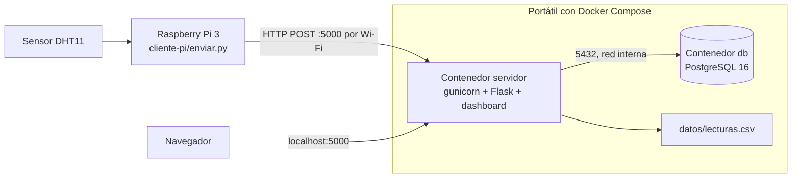

# Monitor de temperatura y humedad de un rack

Una Raspberry Pi 3 con un sensor DHT11 mide la temperatura y la humedad de un rack y envía cada lectura por HTTP a un servidor. El servidor valida el dato, lo clasifica como NORMAL o ALERTA y lo guarda en una base PostgreSQL y en un archivo CSV. Un dashboard muestra las lecturas.

Esta rama corre todo el servidor en un portátil con Docker Compose. La versión desplegada en AWS vive en la rama `raspberry-pi`.

## Arquitectura



El servidor no distingue de dónde viene la lectura. Solo recibe un POST con `dispositivo`, `temperatura` y `humedad`.

El contenedor `servidor` publica el puerto 5000. El contenedor `db` no publica el 5432: solo el servidor llega a la base, por la red interna de Compose. Los datos de PostgreSQL viven en el volumen `pgdata`, y el CSV queda en `datos/lecturas.csv` del portátil, así que ambos sobreviven a recrear los contenedores.

## Levantar el servidor

Hace falta Docker con el plugin de Compose.

```bash
cp .env.example .env
mkdir -p datos && touch datos/lecturas.csv
docker compose up --build -d
docker compose ps
```

El dashboard queda en http://localhost:5000. El archivo `.env` define el usuario, la contraseña y el nombre de la base. La contraseña debe llevar solo letras y números, porque va dentro de una URL. El `.env` no se sube a git.

El archivo `datos/lecturas.csv` debe existir antes de levantar. Si no existe, Docker crea una carpeta con ese nombre y el servidor falla.

## Ver las lecturas

En la base:

```bash
docker compose exec db psql -U rackadmin -d rack -c "SELECT * FROM lecturas ORDER BY id DESC LIMIT 5;"
```

Usa el usuario y la base de tu `.env`. En el CSV:

```bash
tail -5 datos/lecturas.csv
```

El dashboard también tiene un botón para descargar el CSV completo.

## Detener

```bash
docker compose down
```

No uses la opción `-v`: borra el volumen y se pierde la base.

## Enviar desde la Raspberry Pi

El Pi y el portátil deben estar en la misma red. Saca la IP del portátil con `ipconfig` (adaptador Wi-Fi). Esa IP cambia cuando cambias de red.

```bash
cd cliente-pi
SERVIDOR_URL=http://IP_DEL_PORTATIL:5000/api/lecturas DISPOSITIVO=rack-pi-01 MODO=sensor INTERVALO_SEGUNDOS=5 uv run --python 3.12 --with RPi.GPIO enviar.py
```

`--with RPi.GPIO` hace falta porque la librería del sensor lo pide y el entorno de `uv` no lo trae.

Conexión del sensor al Pi: `+` al pin físico 1 (3.3V), `out` al pin físico 7 (GPIO4) y `-` al pin físico 9 (GND). Se alimenta a 3.3V porque los pines del Pi trabajan a ese voltaje.

Variables del cliente:

| Variable | Por defecto | Qué hace |
|---|---|---|
| `SERVIDOR_URL` | `http://127.0.0.1:5000/api/lecturas` | A dónde envía |
| `DISPOSITIVO` | `rack-01` | Nombre del dispositivo |
| `MODO` | `sensor` | `sensor` lee el DHT11, `simulado` envía una lectura falsa etiquetada |
| `INTERVALO_SEGUNDOS` | `10` | Pausa entre lecturas, mínimo 1 |

El DHT11 falla de vez en cuando porque su señal exige tiempos muy exactos. El cliente captura el error, avisa y reintenta en el siguiente ciclo.

## API

| Ruta | Qué hace |
|---|---|
| `POST /api/lecturas` | Recibe `{"dispositivo","temperatura","humedad"}`. Responde 201 con `{"id","estado","fecha"}`, o 400 con `{"error"}` |
| `GET /api/lecturas?limit=N&desde=ISO` | Devuelve `{"total","lecturas":[...]}`, de la más reciente a la más vieja. `limit` por defecto es 20. `desde` es opcional |
| `GET /api/lecturas/csv` | Descarga el CSV completo. 404 si aún no existe |
| `GET /` | Dashboard |

Una lectura es NORMAL si la temperatura está entre 18 y 27 °C y la humedad entre 40 y 60 %. Si no, es ALERTA, y se guarda igual. Una lectura con valores imposibles para el sensor (fuera de 0 a 50 °C o de 0 a 100 %), con campos faltantes o no numéricos se rechaza con 400 y no se guarda.

## Fechas

El servidor pone la fecha de cada lectura en hora de Colombia (`America/Bogota`), fijada en el código con `zoneinfo`. El dispositivo no manda fecha.

## Estructura

| Carpeta | Contenido |
|---|---|
| `servidor/` | Flask: rutas (`app.py`), validación (`validacion.py`), almacenamiento en base y CSV (`almacenamiento.py`) y el dashboard ya compilado en `static/` |
| `dashboard/` | Código fuente del dashboard (React) |
| `cliente-pi/` | Cliente de la Raspberry Pi |
| `docker-compose.yml` | Servidor y PostgreSQL |
